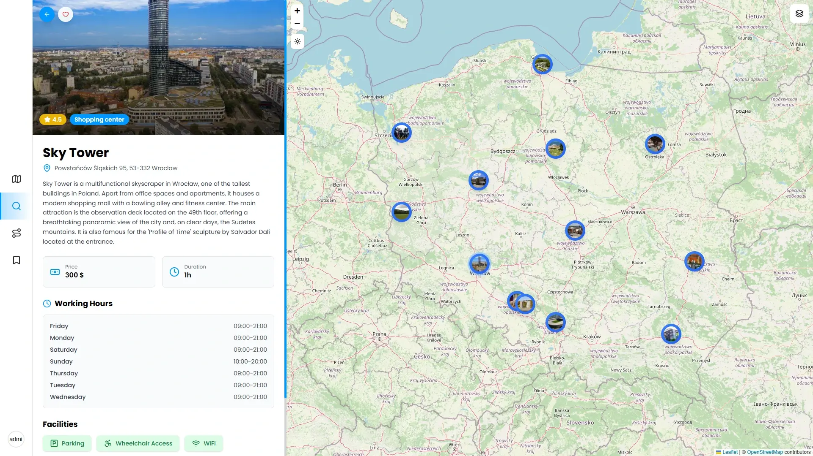
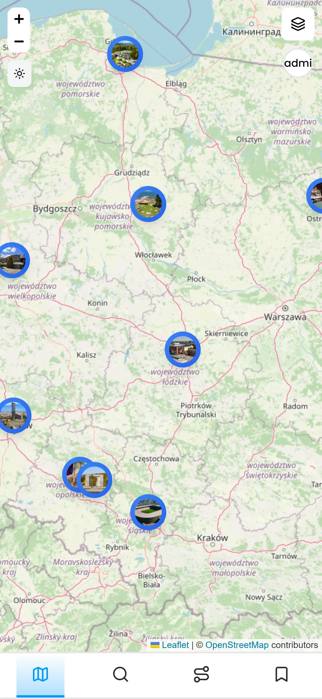
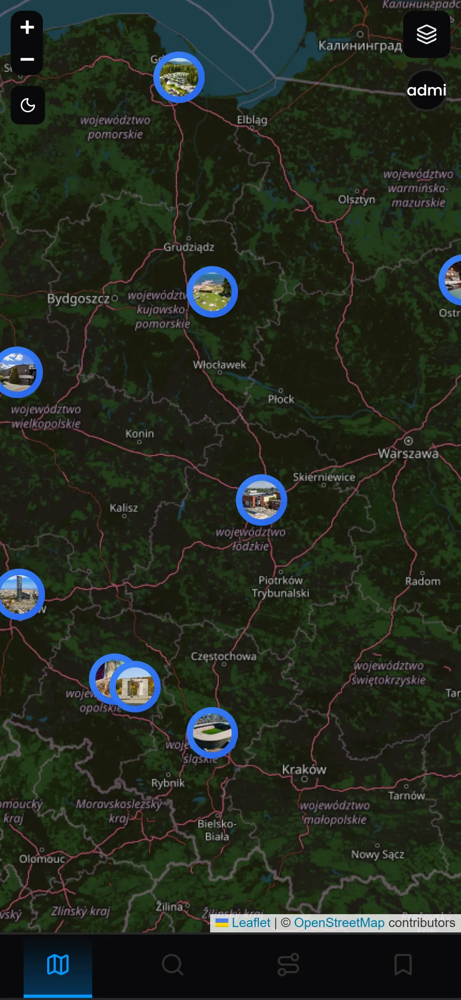

<p align="center">
    
</p>

<h1 align="center">Interactive Travel Map</h1>

<h3 align="center">Find points of interest on an interactive map and plan multi-day trips with daily routes.</h3>

<p align="center">
    <a href="https://github.com/EisOokami/InteractiveMapTrip/stargazers"></a>
    <a href="https://github.com/EisOokami/InteractiveMapTrip/commits"></a>
    <a href="./LICENSE"></a>
    <a href="https://github.com/EisOokami"></a>
</p>

<h4 align="center">🚧 Status: in active development 🚧</h4>

<p align="center">
    <a href="#about">About</a> •
    <a href="#features">Features</a> •
    <a href="#layout">Layout</a> •
    <a href="#started">Getting Started</a> •
    <a href="#tech">Tech Stack</a> •
    <a href="#contribute">Contribute</a> •
    <a href="#author">Author</a> •
    <a href="#license">License</a>
</p>

<p align="center">
    <a href="https://interactive-map-trip.vercel.app/">📱 Visit this Project</a>
</p>

<h2 id="about">📖 About</h2>

**Interactive Travel Map** helps tourists find places worth visiting and turn them into a travel plan. Explore attractions on a Leaflet map, read their details, save favorites, then build a multi-day trip and calculate a driving, cycling or walking route for every day.

The repository contains two applications:

| Folder      | What it is                                                                             |
| ----------- | -------------------------------------------------------------------------------------- |
| `frontend/` | Next.js web app: landing page, map, place details, trip planner, accounts and settings |
| `backend/`  | Express REST API on MySQL / MariaDB: accounts, places, favorites and the AI assistant  |

<h3>How the trip planner works</h3>

1. Sign in, explore the map and save places with the heart button.
2. Open the Trip Planner, create a named trip with a date range and pick a day.
3. Add saved places, or add a place directly from its details. Reorder stops with the drag handle; keyboard users press Space, use the arrow keys and press Space again to drop.
4. Choose the transport mode for the day. The map draws the route and shows the day totals and the available trip totals.
5. Optionally ask the AI Trip Assistant to review the day and apply its suggested order.

<h2 id="layout">🎨 Layout</h2>

<p align="center">
    <picture>
        <source media="(prefers-color-scheme: dark)" srcset="frontend/public/map-page2.webp" />
        
    </picture>
</p>

<p align="center">
    
    
</p>

<h2 id="started">🚀 Getting Started</h2>

<h3>Prerequisites</h3>

- [Git](https://git-scm.com)
- [Node.js](https://nodejs.org/) 22 or newer with npm
- [MySQL](https://www.mysql.com/) or [MariaDB](https://mariadb.org/) with the application data. The base tables (users, places, favorites) and the place data are not included in this repository.
- A [Mapbox](https://www.mapbox.com/) public token for route calculations. The optional Thunderforest layer needs its own [API key](https://www.thunderforest.com/).
- Optional: a Google OAuth client (Google sign-in), an SMTP mailbox (verification emails), a [Gemini API key](https://ai.google.dev/) (AI Trip Assistant) and [Docker](https://www.docker.com/) (log monitoring)

<h3>Cloning</h3>

```bash
git clone https://github.com/EisOokami/InteractiveMapTrip.git
cd InteractiveMapTrip
```

<h3>Installing dependencies</h3>

Each application has its own `package.json`; the root one only holds release tooling.

```bash
npm --prefix backend install
npm --prefix frontend install
```

<h3>Environment variables</h3>

**Backend** (`backend/.env`, commented template: `backend/.env.example`)

| Variable                                                          | Description                                                                                                                                               |
| ----------------------------------------------------------------- | --------------------------------------------------------------------------------------------------------------------------------------------------------- |
| `NODE_ENV`, `PORT`                                                | Runtime mode and API port (`3001`)                                                                                                                        |
| `DB_HOST`, `DB_PORT`, `DB_USER`, `DB_PASSWORD`, `DB_DATABASE`     | Database connection (default database: `interactive_travel_map`)                                                                                          |
| `JWT_ACCESS_SECRET`, `JWT_REFRESH_SECRET`                         | Secrets for signing access and refresh tokens                                                                                                             |
| `CSRF_SECRET`                                                     | Secret for CSRF tokens                                                                                                                                    |
| `MFA_ENCRYPTION_KEY`                                              | Encrypts stored 2FA secrets, at least 32 characters                                                                                                       |
| `LOGIN_CODE_SECRET`, `DELETION_CODE_SECRET`                       | Sign the email codes for login and account deletion                                                                                                       |
| `EMAIL_SERVICE`, `EMAIL_USER`, `EMAIL_PASSWORD`                   | Mailbox used by Nodemailer                                                                                                                                |
| `WEB_URL`                                                         | Frontend URL used in email links, e.g. `http://localhost:3000`                                                                                            |
| `HOSTS`, `CORS_URLS`                                              | Comma-separated allowed hosts and origins                                                                                                                 |
| `TRUST_PROXY`                                                     | Reverse proxies in front of the API that may set `X-Forwarded-For` (addresses, subnets or `loopback`, `uniquelocal`). Empty: the header is ignored        |
| `BFF_SHARED_SECRET`                                               | Same value as in the frontend, at least 32 characters. The API takes the visitor address from the Next.js server only with this secret                    |
| `GOOGLE_CLIENT_ID`, `GOOGLE_CLIENT_SECRET`, `GOOGLE_REDIRECT_URI` | Google sign-in. The redirect URI is `<API URL>/auth/google/callback`                                                                                      |
| `TERMS_VERSION`, `PRIVACY_VERSION`                                | Current versions of `/terms` and `/privacy`. After a bump, users accept them at the next sign-in                                                          |
| `LOG_LEVEL`, `LOG_FILE`                                           | Log level and optional log file (set `LOG_FILE=./logs/app.log` to feed Grafana)                                                                           |
| `GEMINI_MODEL`                                                    | Gemini model of the AI Trip Assistant (default `gemini-3.5-flash-lite`). There is no server key: each user adds their own Gemini API key in the assistant |

**Frontend** (`frontend/.env`, commented template: `frontend/.env.example`)

| Variable                                                                                                               | Description                                                                                                                                                                                                                                                                              |
| ---------------------------------------------------------------------------------------------------------------------- | ---------------------------------------------------------------------------------------------------------------------------------------------------------------------------------------------------------------------------------------------------------------------------------------- |
| `NEXT_PUBLIC_DB_URL`                                                                                                   | Public API address used by the browser and most server-side requests, e.g. `http://localhost:3001`                                                                                                                                                                                       |
| `DB_URL`                                                                                                               | API address used by the server to refresh sessions; usually the same value                                                                                                                                                                                                               |
| `NEXT_PUBLIC_MAPBOX_API_KEY`                                                                                           | Mapbox token for the satellite layer and route planning                                                                                                                                                                                                                                  |
| `NEXT_PUBLIC_THUNDERFOREST_API_KEY`                                                                                    | Thunderforest key for the cycling map layer                                                                                                                                                                                                                                              |
| `HOST`                                                                                                                 | Domain of the session cookies (default `localhost`); set your domain in production                                                                                                                                                                                                       |
| `BFF_SHARED_SECRET`                                                                                                    | Same value as in `backend/.env`, at least 32 characters. Without it the API counts rate limits per Next.js server instead of per visitor                                                                                                                                                 |
| `CLIENT_IP_HEADER`                                                                                                     | Header with the visitor address set by the proxy in front of Next.js (e.g. `x-real-ip` behind nginx). Leave empty locally and on Vercel, where `x-real-ip` is used automatically (`VERCEL=1` is set by Vercel). Never use a header the browser can set itself, such as `x-forwarded-for` |
| `NEXT_PUBLIC_SITE_URL`                                                                                                 | Public address of the service shown in the Privacy Policy and Terms of Service                                                                                                                                                                                                           |
| `TERMS_VERSION`, `PRIVACY_VERSION`                                                                                     | Versions shown on `/terms` and `/privacy` (default `1.0`). Keep them equal to the API values                                                                                                                                                                                             |
| `LEGAL_OPERATOR`, `LEGAL_CONTACT_EMAIL`                                                                                | Operator (data controller) and contact e-mail named in `/privacy` and `/terms`                                                                                                                                                                                                           |
| `LEGAL_SERVER_PROVIDER`, `LEGAL_BACKUP_RETENTION`                                                                      | Server provider and country, and backup retention named in the Privacy Policy. Empty `LEGAL_*` values are shown as highlighted `[DO UZUPEŁNIENIA: …]` placeholders                                                                                                                       |
| `LEGAL_LAST_TERMS_UPDATED`, `LEGAL_EFFECTIVE_TERMS_DATE`, `LEGAL_LAST_PRIVACY_UPDATED`, `LEGAL_EFFECTIVE_PRIVACY_DATE` | Dates shown in the documents, e.g. `20 listopada 2026 r.`                                                                                                                                                                                                                                |
| `LEGAL_REPOSITORY_URL`, `LEGAL_LICENSE_URL`                                                                            | Repository and license links in the Terms of Service (default: this repository on GitHub)                                                                                                                                                                                                |

`NEXT_PUBLIC_*` values are built into the bundle by `next build`: rebuild the frontend after changing them.

<h3>Preparing the database</h3>

```bash
mariadb -u root -p interactive_travel_map < backend/database/database.sql
```

<h3>Starting</h3>

Start the API in one terminal:

```bash
npm --prefix backend run dev        # or: npm --prefix backend run build && npm --prefix backend start
```

Start the web app in a second terminal:

```bash
npm --prefix frontend run dev
```

Open [http://localhost:3000/map](http://localhost:3000/map).

<h3>Log monitoring (optional)</h3>

The API writes JSON logs to stdout. To browse them in Grafana, set `LOG_FILE=./logs/app.log` in `backend/.env` and start Loki, Promtail and Grafana:

```bash
cp .env.example .env    # then set GRAFANA_ADMIN_PASSWORD
docker compose up -d
```

The root `.env` holds only the Grafana settings (`GRAFANA_ADMIN_USER`, `GRAFANA_ADMIN_PASSWORD`, `GRAFANA_ALLOW_SIGN_UP`, `GRAFANA_INSTALL_PLUGINS`); Grafana and Loki are published on `127.0.0.1` only.

Grafana opens on [http://localhost:3200](http://localhost:3200) with the "Express Backend - Security Audit" dashboard.

<h3>Useful scripts</h3>

| Where       | Command                       | What it does                       |
| ----------- | ----------------------------- | ---------------------------------- |
| `backend/`  | `npm run dev`                 | Start the API with hot reload      |
| `backend/`  | `npm run build` / `npm start` | Compile TypeScript and run `dist/` |
| `frontend/` | `npm run dev`                 | Start Next.js in development mode  |
| `frontend/` | `npm run build` / `npm start` | Production build and server        |
| `frontend/` | `npm run lint`                | Run ESLint                         |

<h2 id="tech">💻 Tech Stack</h2>

#### **Frontend** ([Next.js 16](https://nextjs.org/) + [React 19](https://react.dev/) + [TypeScript](https://www.typescriptlang.org/))

- **[Leaflet](https://leafletjs.com/)** and **[React Leaflet](https://react-leaflet.js.org/)** for the map
- **[Leaflet Routing Machine](https://www.liedman.net/leaflet-routing-machine/)** with **[Mapbox](https://www.mapbox.com/)** routing
- **[Zustand](https://zustand.docs.pmnd.rs/)** for client state
- **[dnd kit](https://dndkit.com/)** for drag-and-drop
- **[Tailwind CSS](https://tailwindcss.com/)**, **[SCSS](https://sass-lang.com/)**, **[shadcn/ui](https://ui.shadcn.com/)** and **[Radix UI](https://www.radix-ui.com/)**
- **[Framer Motion](https://motion.dev/)** for animations
- **[Zod](https://zod.dev/)** for validation
- **[next-themes](https://github.com/pacocoursey/next-themes)**, **[Sonner](https://sonner.emilkowal.ski/)**, **[date-fns](https://date-fns.org/)** and **[Lucide](https://lucide.dev/)** icons

> See [frontend/package.json](./frontend/package.json)

#### **Backend** ([Node.js](https://nodejs.org/) + [Express 5](https://expressjs.com/) + [TypeScript](https://www.typescriptlang.org/))

- **[MySQL / MariaDB](https://mariadb.org/)** through **[mysql2](https://github.com/sidorares/node-mysql2)**
- **[jose](https://github.com/panva/jose)** (JWT), **[bcryptjs](https://github.com/dcodeIO/bcrypt.js)**, **[otplib](https://github.com/yeojz/otplib)** and **[qrcode](https://github.com/soldair/node-qrcode)** for authentication and 2FA
- **[Google Auth Library](https://github.com/googleapis/google-auth-library-nodejs)** for Google sign-in
- **[Google Gen AI SDK](https://github.com/googleapis/js-genai)** for the AI Trip Assistant
- **[Nodemailer](https://nodemailer.com/)** for emails
- **[Helmet](https://helmetjs.github.io/)**, **[express-rate-limit](https://github.com/express-rate-limit/express-rate-limit)**, **[hpp](https://github.com/analog-nico/hpp)**, **[express-xss-sanitizer](https://github.com/AhmedAdelFahim/express-xss-sanitizer)**, **[host-validation](https://github.com/brannondorsey/host-validation)**
- **[Pino](https://getpino.io/)** for logging
- **[Zod](https://zod.dev/)** for validation

> See [backend/package.json](./backend/package.json)

#### **Utils**

- Maps: **[OpenStreetMap](https://www.openstreetmap.org/)**, **[Thunderforest](https://www.thunderforest.com/)**
- Routing: **[Mapbox Directions](https://docs.mapbox.com/api/navigation/directions/)**
- Monitoring: **[Grafana](https://grafana.com/)**, **[Loki](https://grafana.com/oss/loki/)**, **[Promtail](https://grafana.com/docs/loki/latest/send-data/promtail/)**
- Releases: **[semantic-release](https://semantic-release.gitbook.io/)**

<h2 id="contribute">📫 Contribute</h2>

1. Fork the project and clone your fork
2. Create a branch: `git checkout -b feature/your-feature`
3. Commit your changes following [Conventional Commits](https://www.conventionalcommits.org/) (`feat: ...`, `fix: ...`); releases are generated from them
4. Push the branch: `git push origin feature/your-feature`
5. Open a Pull Request that explains the problem or feature, and add screenshots for visual changes

The repository includes templates for [bug reports, feature requests](./.github/ISSUE_TEMPLATE) and [pull requests](./.github/PULL_REQUEST_TEMPLATE.md).

<h3>Documentation that might help</h3>

[📝 How to create a Pull Request](https://docs.github.com/en/pull-requests/collaborating-with-pull-requests/proposing-changes-to-your-work-with-pull-requests/creating-a-pull-request)

[💾 Commit pattern](https://gist.github.com/joshbuchea/6f47e86d2510bce28f8e7f42ae84c716)

<h3>Acknowledgments</h3>

- [Najciekawsze Na Wsi](https://mapa.najciekawszenawsi.pl/#/map/new_trip) for the inspiration
- [awesome-readme](https://github.com/matiassingers/awesome-readme)

<h2 id="author">👤 Author</h2>

<table>
    <tr>
        <td align="center">
            <a href="https://github.com/EisOokami">
                <br />
                <sub><b>EisOokami</b></sub>
            </a>
        </td>
    </tr>
</table>

<h2 id="license">📝 License</h2>

This project is distributed under the [MIT License](./LICENSE).
